

  <picture>
    <source media="(max-width: 600px) and (prefers-color-scheme: light)" srcset="./assets/hero-light-mobile.svg">
    <source media="(max-width: 600px)" srcset="./assets/hero-dark-mobile.svg">
    <source media="(prefers-reduced-motion: reduce) and (prefers-color-scheme: light)" srcset="./assets/hero-light.svg">
    <source media="(prefers-reduced-motion: reduce)" srcset="./assets/hero-dark.svg">
    <source media="(prefers-color-scheme: light)" srcset="./assets/readme/hero-light.gif">
    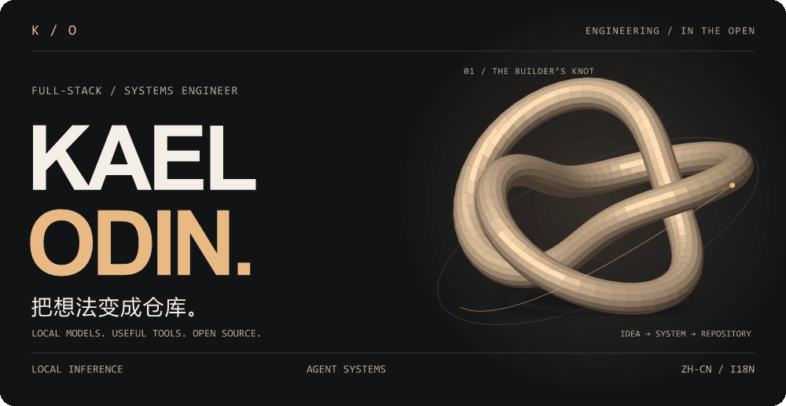
  </picture>

  <a href="https://odin-saga.vercel.app/"><b>Blog ↗</b></a> &nbsp; / &nbsp;
  <a href="https://github.com/kael-odin?tab=repositories"><b>Repositories ↗</b></a> &nbsp; / &nbsp;
  <a href="https://github.com/kael-odin/kael-odin/issues"><b>Say hello ↗</b></a>

 

我是 **Kael Odin**，全栈 / 系统工程师，就职于 [Thordata](https://github.com/Thordata)。

白天做后端服务和数据管道，业余折腾本地大模型、Agent 工具链与中文本地化。喜欢把麻烦事变成可以直接运行的工具，再把过程写进开源仓库。

*I build backend systems, explore local inference, and make useful tools more accessible.*

 

## 01 &nbsp; Selected builds · 做过的一些东西

<a href="https://github.com/kael-odin/awesome-academic-research-skills">
  <picture>
    <source media="(max-width: 600px) and (prefers-color-scheme: light)" srcset="./assets/readme/project-research-light-mobile.png">
    <source media="(max-width: 600px)" srcset="./assets/readme/project-research-dark-mobile.png">
    <source media="(prefers-color-scheme: light)" srcset="./assets/readme/project-research-light.png">
    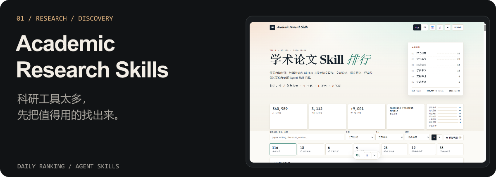
  </picture>
</a>

[浏览科研 Skill 排行 ↗](https://kael-odin.github.io/awesome-academic-research-skills/) · [源码](https://github.com/kael-odin/awesome-academic-research-skills)

 

<a href="https://github.com/kael-odin/codex-plugins-zh">
  <picture>
    <source media="(max-width: 600px) and (prefers-color-scheme: light)" srcset="./assets/readme/project-plugins-light-mobile.png">
    <source media="(max-width: 600px)" srcset="./assets/readme/project-plugins-dark-mobile.png">
    <source media="(prefers-color-scheme: light)" srcset="./assets/readme/project-plugins-light.png">
    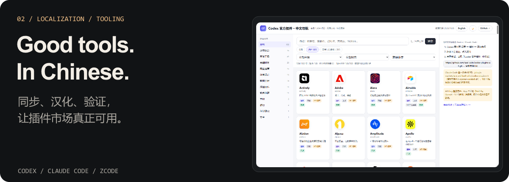
  </picture>
</a>

[Codex 插件中文市场 ↗](https://kael-odin.github.io/codex-plugins-zh/) · [Claude Code 插件中文市场 ↗](https://kael-odin.github.io/claude-plugins-zh/) · [ZCode ↗](https://kael-odin.github.io/zcode-plugins-zh/)

 

<a href="https://github.com/kael-odin/2080ti-22G-kvmem-qwen3.8-27B-256K-36.6toks">
  <picture>
    <source media="(max-width: 600px) and (prefers-color-scheme: light)" srcset="./assets/project-gpu-light-mobile.svg">
    <source media="(max-width: 600px)" srcset="./assets/project-gpu-dark-mobile.svg">
    <source media="(prefers-color-scheme: light)" srcset="./assets/project-gpu-light.svg">
    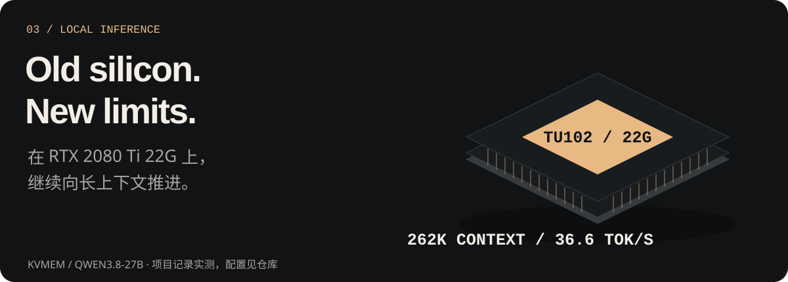
  </picture>
</a>

[查看推理配置、实测与复现链 ↗](https://github.com/kael-odin/2080ti-22G-kvmem-qwen3.8-27B-256K-36.6toks)

 

<a href="https://github.com/kael-odin/odin-bifrost">
  <picture>
    <source media="(max-width: 600px) and (prefers-color-scheme: light)" srcset="./assets/readme/project-bifrost-light-mobile.png">
    <source media="(max-width: 600px)" srcset="./assets/readme/project-bifrost-dark-mobile.png">
    <source media="(prefers-color-scheme: light)" srcset="./assets/readme/project-bifrost-light.png">
    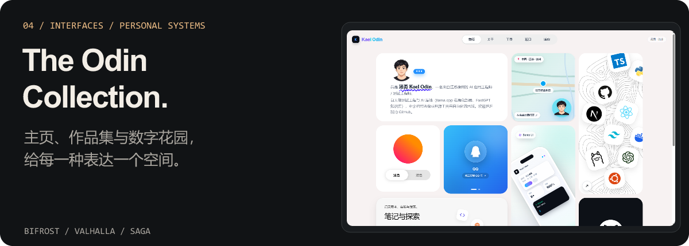
  </picture>
</a>

[Bifrost ↗](https://kael-odin.github.io/odin-bifrost/) · [Valhalla ↗](https://kael-odin.github.io/odin-valhalla/) · [Runestone ↗](https://kael-odin.github.io/odin-runestone/) · [Heim ↗](https://kael-odin.github.io/odin-heim/) · [Saga ↗](https://odin-saga.vercel.app/)

<b>More experiments · 还有这些</b>

 

- **[Heimdall](https://github.com/kael-odin/heimdall)** — 网页镜像、站点图谱、可维护重建与还原度验证。
- **[OpenWorker 中文版](https://github.com/kael-odin/openworker)** — 追踪上游、本地优先的中文任务型 AI；基于上游项目维护。
- **[Amadeus Agent](https://github.com/kael-odin/Amadeus-Agent)** — 单文件智能体工作台，零构建、浏览器本地存储。
- **[free-for-dev 中文版](https://github.com/kael-odin/free-for-dev-zh/)** — 免费开发者服务导航、增量翻译与大陆可用性标注。
- **[prompts.chat 中文镜像](https://github.com/kael-odin/prompts-chat-zh)** — 提示词中英对照、全文搜索和自动更新。

[全部仓库 →](https://github.com/kael-odin?tab=repositories)

 

## 02 &nbsp; Areas of interest · 长期折腾的方向

<picture>
  <source media="(max-width: 600px) and (prefers-color-scheme: light)" srcset="./assets/focus-light-mobile.svg">
  <source media="(max-width: 600px)" srcset="./assets/focus-dark-mobile.svg">
  <source media="(prefers-color-scheme: light)" srcset="./assets/focus-light.svg">
  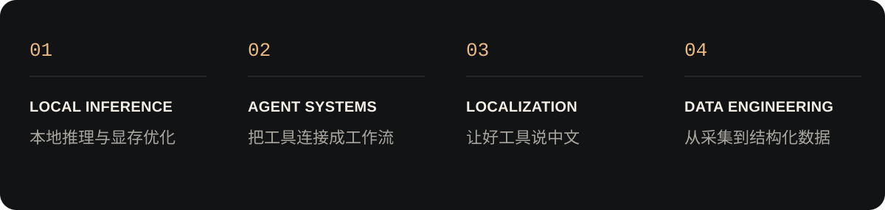
</picture>

 

## 03 &nbsp; Toolkit · 用来把东西做出来

<picture>
  <source media="(max-width: 600px) and (prefers-color-scheme: light)" srcset="./assets/toolkit-light-mobile.svg">
  <source media="(max-width: 600px)" srcset="./assets/toolkit-dark-mobile.svg">
  <source media="(prefers-color-scheme: light)" srcset="./assets/toolkit-light.svg">
  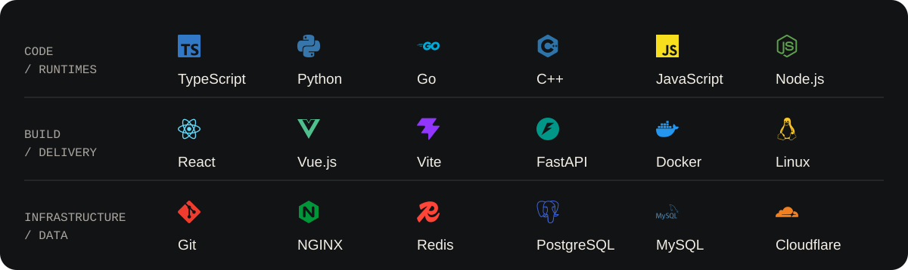
</picture>

 

## 04 &nbsp; In the open · 公开构建记录

<picture>
  <source media="(max-width: 600px) and (prefers-color-scheme: light)" srcset="./assets/stats-light-mobile.svg">
  <source media="(max-width: 600px)" srcset="./assets/stats-dark-mobile.svg">
  <source media="(prefers-color-scheme: light)" srcset="./assets/stats-light.svg">
  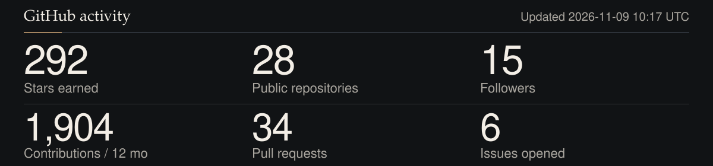
</picture>

 

<picture>
  <source media="(max-width: 600px) and (prefers-color-scheme: light)" srcset="./assets/langs-light-mobile.svg">
  <source media="(max-width: 600px)" srcset="./assets/langs-dark-mobile.svg">
  <source media="(prefers-color-scheme: light)" srcset="./assets/langs-light.svg">
  
</picture>

自托管面板，由 GitHub Actions 更新。[原始公开数据快照](./assets/profile-data.json) · 语言统计口径为仓库代码字节，不是能力评分。

 

<picture>
  <source media="(prefers-color-scheme: light)" srcset="https://raw.githubusercontent.com/kael-odin/kael-odin/output/snake-light.svg">
  
</picture>

Contribution landscape · 立体贡献图

 

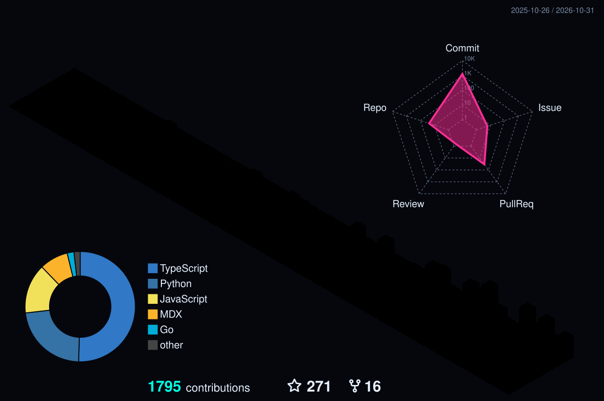

 

## 05 &nbsp; Field notes · 最近写的

<!-- BLOG-POST-LIST:START -->
- [2025 Blog 的使用引导](https://odin-saga.vercel.app/blog/readme) · 2025-11-16
<!-- BLOG-POST-LIST:END -->

[继续阅读 Odin Saga →](https://odin-saga.vercel.app/)

 

<picture>
  <source media="(max-width: 600px) and (prefers-color-scheme: light)" srcset="./assets/footer-light-mobile.svg">
  <source media="(max-width: 600px)" srcset="./assets/footer-dark-mobile.svg">
  <source media="(prefers-color-scheme: light)" srcset="./assets/footer-light.svg">
  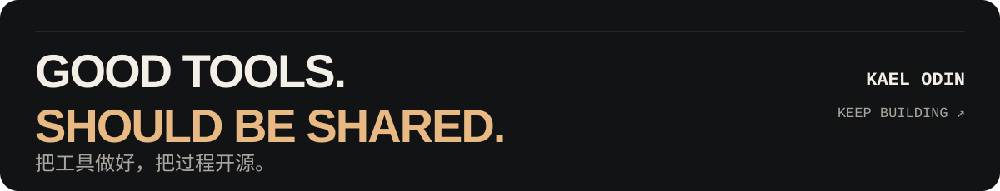
</picture>

Colophon · 关于这个页面

 

- **视觉**：原创三叶结金属网格、透视 GPU 示意与自托管 SVG。首屏 GIF 与静态 SVG 来自同一套几何和光照计算，不依赖外部动图服务。
- **适配**：深浅主题、独立手机端构图，以及 `prefers-reduced-motion` 静态回退。
- **作品画面**：来自本人公开站点的真实截图，拍摄于 **2026-11-04**，不是实时数据面板。
- **图标**：[Simple Icons](https://simpleicons.org/) 的 CC0 路径，品牌商标归各自权利人。
- **镜头参考**：吸收 [video-shotcraft](https://github.com/Vincentwei1021/video-shotcraft) 的分层景深、单主体聚光与稳定构图思路；这里的画面和实现均为本仓库原创。
- **生成与维护**：[构建说明](./DESIGN.md) · [视觉生成器](./scripts/build_assets.py) · [数据生成器](./scripts/generate_stats.py)。

